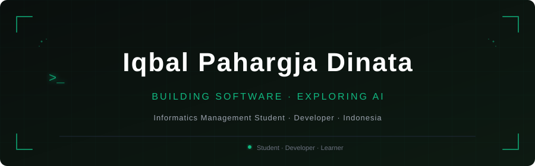

<div align="center">
  
</div>

<br/>

<!-- ═══════════════════════════════════════════════════════════
     ABOUT ME
════════════════════════════════════════════════════════════ -->

## About Me

I am a 5th-semester **Informatics Management** student at **Universitas Negeri Surabaya**, Indonesia.
I enjoy building things — from mobile apps and web systems to small automation scripts — and I am genuinely curious about where software, AI, and engineering systems intersect.

Right now I am focused on sharpening my fundamentals, exploring agentic AI concepts, and building projects that solve real problems. I believe the best way to learn is to build, break, and iterate.

```text
Location  │  Indonesia 🇮🇩
Study     │  Informatics Management — Universitas Negeri Surabaya
Semester  │  5th
Interests │  Software Development · Artificial Intelligence · DevOps · Automation
```

<br/>

<!-- ═══════════════════════════════════════════════════════════
     CURRENT FOCUS
════════════════════════════════════════════════════════════ -->

## Current Focus

| Area | Status |
|------|--------|
| Agentic AI & AI-assisted automation | 🔬 Exploring |
| Backend development — Laravel & REST APIs | 🛠 Practicing |
| DevOps, deployment & server infrastructure | 📚 Learning |
| Mobile development — Flutter & Dart | 🛠 Practicing |
| AI / ML engineering fundamentals | 📚 Learning |
| Strengthening core programming skills | ⚙️ Ongoing |

<br/>

<!-- ═══════════════════════════════════════════════════════════
     TECH STACK
════════════════════════════════════════════════════════════ -->

## Tech Stack

**Programming Languages**


**Frameworks & Platforms**


**Databases & Backend Services**


**Tools**


<br/>

<!-- ═══════════════════════════════════════════════════════════
     FEATURED PROJECTS
════════════════════════════════════════════════════════════ -->

## Featured Projects

<table>
  <tr>
    <td width="50%" valign="top">
      <h3>💸 Split Spot</h3>
      <p>Flutter mobile app for splitting group expenses based on individual menu items. Each person pays only for what they ordered.</p>
      <p>
        <strong>Stack:</strong> Flutter · Dart · Firebase Auth · Cloud Firestore<br/>
        <strong>Features:</strong> Event management, item-level expense allocation, real-time sync
      </p>
      <p>
        <a href="https://github.com/iqbalDt/split-spot">
          
        </a>
      </p>
    </td>
    <td width="50%" valign="top">
      <h3>🎮 Train of Souls</h3>
      <p>A Unity 2D game featuring multiple scenes, NPC dialogue, player decision-making, and branching narrative endings.</p>
      <p>
        <strong>Stack:</strong> Unity · C#<br/>
        <strong>Features:</strong> Multi-scene navigation, NPC interactions, branching story outcomes
      </p>
      <p>
        <a href="https://github.com/iqbalDt/train-of-souls">
          
        </a>
      </p>
    </td>
  </tr>
  <tr>
    <td width="50%" valign="top">
      <h3>🥬 PantauPangan</h3>
      <p>Food-price monitoring platform using crowdsourced data, with per-item price history graphs and integrated food-related news.</p>
      <p>
        <strong>Stack:</strong> PHP · MySQL · Laravel<br/>
        <strong>Features:</strong> Crowdsourced price submissions, trend graphs, news feed
      </p>
      <p>
        <a href="https://github.com/iqbalDt/pantaupangan">
          
        </a>
      </p>
    </td>
    <td width="50%" valign="top">
      <h3>🌾 Didopek</h3>
      <p>Web platform built for farmers — providing weather information, financial planning tools, activity calendars, and user authentication.</p>
      <p>
        <strong>Stack:</strong> PHP · Laravel · MySQL<br/>
        <strong>Features:</strong> Weather integration, financial planning, calendar, auth
      </p>
      <p>
        <a href="https://github.com/iqbalDt/didopek">
          
        </a>
      </p>
    </td>
  </tr>
</table>

<br/>

<!-- ═══════════════════════════════════════════════════════════
     GITHUB STATISTICS
     Theme: To change theme, replace "?theme=..." with any
     supported theme name from anuraghazra/github-readme-stats.
     Available dark themes: dark, radical, merko, gruvbox,
     tokyonight, onedark, cobalt, synthwave, highcontrast.
════════════════════════════════════════════════════════════ -->

## GitHub Statistics

<div align="center">

  
  &nbsp;
  

</div>

<!--
  Streak Stats (optional — uses streak-stats.demolab.com).
  Uncomment the block below after confirming the service is reachable.
  If the card shows an error, the service may be temporarily unavailable.

  
-->

<br/>

<!-- ═══════════════════════════════════════════════════════════
     CURRENTLY LEARNING
════════════════════════════════════════════════════════════ -->

## Currently Learning

```python
learning = {
    "AI / ML":     ["Fundamentals of machine learning", "Agentic AI concepts", "Prompt engineering"],
    "DevOps":      ["Linux server basics", "Deployment workflows", "CI/CD concepts"],
    "Backend":     ["Laravel advanced patterns", "REST API design", "Database optimization"],
    "Automation":  ["Python scripting", "Workflow automation tools"],
}

# Building understanding — not yet production-experienced in these areas
```

<br/>

<!-- ═══════════════════════════════════════════════════════════
     CONNECT WITH ME
════════════════════════════════════════════════════════════ -->

## Connect With Me

<div align="left">

[](https://github.com/iqbalDt)
[](https://linkedin.com/in/iqbal-dinata)
[](https://instagram.com/iqbaal.dt)
[](mailto:iqbaldinata12345@gmail.com)

</div>

<br/>

<!-- ═══════════════════════════════════════════════════════════
     FOOTER
════════════════════════════════════════════════════════════ -->

<div align="center">
  
  <br/>
  <sub><code>// Curious. Disciplined. Continuously learning.</code></sub>
</div>
